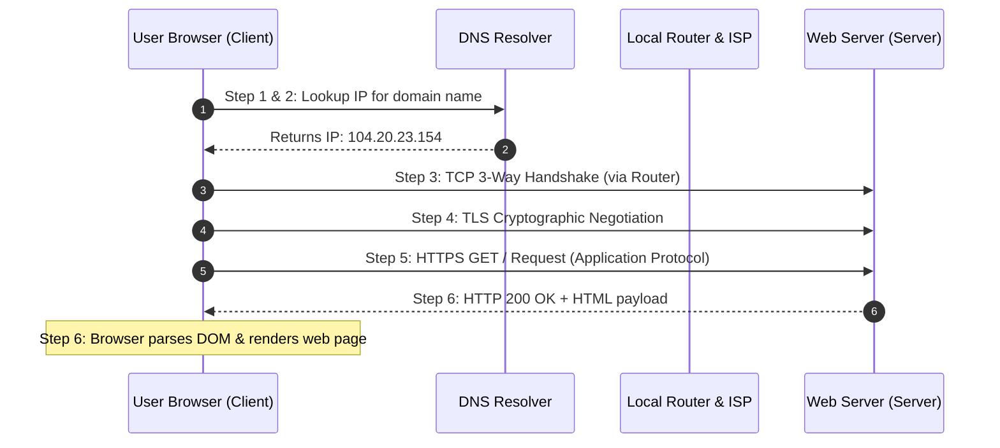

# Mission 7 — How computers communicate

## 1. Task / objective
The objective of Mission 7 is to examine computer networking fundamentals and protocol architectures. This includes defining key network scope models (LAN, MAN, WAN), routing, DNS translation, packet switching, and client-server paradigms; conducting practical connectivity and DNS resolution tests from the terminal; and explaining the complete step-by-step lifecycle of navigating to a website.

---

## 2. Work completed
- Compiled a comprehensive network concepts table with original definitions and real-world infrastructure examples.
- Conducted terminal-based ICMP packet reachability tests (`ping -c 3 example.com`) and analyzed latency metrics and packet loss.
- Executed DNS resolution queries (`nslookup example.com`), observing how domain names map to IP address records.
- Formulated an exact 6-step walkthrough describing what happens when a user requests a web page in a browser, correctly integrating terms: *client*, *server*, *DNS*, and *protocol*.
- Applied strict privacy safeguards, redacting internal router gateways and local resolver IP addresses (`[redacted]`).

---

## 3. Commands / tools used
- `ping -c 3 example.com`: Sends 3 ICMP Echo Request packets to test end-to-end network reachability, packet loss, and round-trip latency.
- `nslookup example.com`: Queries configured DNS nameservers to resolve a fully qualified domain name into IPv4 addresses.

---

## 4. My understanding

### Task 7.1 — Explain network concepts

| Concept | Explain it in your own words | Example |
| :--- | :--- | :--- |
| **LAN (Local Area Network)** | A privately managed network interconnecting computers and devices within a limited physical radius, such as a single room, residence, or office suite. | A home Wi-Fi network connecting a laptop, smartphone, and smart TV via a wireless access point. |
| **MAN (Metropolitan Area Network)** | A high-bandwidth network infrastructure spanning an entire city or a multi-building university campus, connecting multiple LANs. | A citywide municipal fiber-optic network connecting civic libraries, police stations, and university campus buildings. |
| **WAN (Wide Area Network)** | A telecommunications network spanning large geographical distances, across regional, national, or international boundaries. | The global Internet, connecting internet service providers (ISPs), submarine fiber cables, and satellite links worldwide. |
| **DNS (Domain Name System)** | The decentralized directory service that translates human-friendly alphanumeric domain names into machine-routable numerical IP addresses. | Translating `example.com` into IPv4 address `93.184.216.34` or `104.20.23.154`. |
| **Router** | A networking layer device (OSI Layer 3) that directs data packets between disparate networks by inspecting destination IP headers and consulting routing tables. | A home wireless gateway router forwarding traffic from local devices out onto the ISP's broadband network. |
| **Protocol** | A standardized set of syntactic and semantic rules governing how devices format, transmit, verify, and receive data across a network. | **HTTP/HTTPS** for web hypertext, **TCP** for reliable stream transmission, and **IP** for packet addressing. |
| **Packet switching** | The communication method where messages are divided into small, independent chunks (packets) routed dynamically across shared network links and reassembled at the destination. | Streaming a video where chunks travel independently along diverse physical paths across the Internet before being buffered by the player. |
| **Client-server** | A distributed computing model where service requester devices (clients) initiate requests to centralized, always-listening resource providers (servers). | A web browser (client) requesting an HTML web page from an Apache/Nginx web server hosting a website. |

---

### Task 7.2 — Observe network information

#### 1. Connectivity Test Observation (`ping -c 3 example.com`)
```
PING example.com (104.20.23.154): 56 data bytes
64 bytes from 104.20.23.154: icmp_seq=0 ttl=47 time=58.460 ms
64 bytes from 104.20.23.154: icmp_seq=1 ttl=47 time=69.009 ms
64 bytes from 104.20.23.154: icmp_seq=2 ttl=47 time=124.314 ms

--- example.com ping statistics ---
3 packets transmitted, 3 packets received, 0.0% packet loss
round-trip min/avg/max/stddev = 58.460/83.928/124.314/28.880 ms
```

#### 2. DNS Lookup Observation (`nslookup example.com`)
```
Server:		[redacted-dns-server]
Address:	[redacted-dns-server]#53

Non-authoritative answer:
Name:	example.com
Address: 172.66.147.243
Name:	example.com
Address: 104.20.23.154
```

#### Diagnostic Questions & Answers
1. **What does a connectivity test help you check?**  
   A connectivity test (`ping`) verifies whether a remote host is powered on, actively listening, and reachable across intermediate routing nodes. It also measures round-trip latency (time required for an ICMP packet to reach the target and return) and packet loss percentage, identifying network congestion or line drops.
2. **What information does a DNS lookup display?**  
   It reveals the resolver server used to handle the request (port 53) and maps the queried hostname (`example.com`) to its corresponding IPv4/IPv6 resource records (e.g. `104.20.23.154`). It also indicates whether the response came directly from the authoritative nameserver or a cached non-authoritative resolver.
3. **What is the role of DNS when entering a website name in a browser?**  
   Humans recall textual domain names, but Internet routing protocols require numerical IP addresses. When a user types a URL, DNS acts as the essential directory lookup service: without resolving the hostname to an IP address, the client browser cannot know where to establish a TCP/IP network connection.

---

### Task 7.3 — What happens when you open a website?
A complete 6-step lifecycle of accessing `https://example.com`:



1. **Step 1: User Input & Local Cache Check**  
   The user types `https://example.com` into the web browser (**client**). The browser checks its local memory cache and the OS cache to see if the IP address for `example.com` was recently resolved.
2. **Step 2: DNS Resolution**  
   If not cached, the client issues a **DNS** request through the local **router** to a recursive DNS resolver. The resolver queries the root nameserver, the `.com` Top-Level Domain (TLD) nameserver, and finally the authoritative nameserver for `example.com`, returning its numerical IP address (e.g., `104.20.23.154`) back to the client.
3. **Step 3: Network Routing & Connection Establishment (TCP)**  
   The client creates packets addressed to `104.20.23.154` on port 443. The local **router** forwards these packets using **packet switching** across regional ISPs and internet backbones. The client and **server** perform the Transmission Control **Protocol** (TCP) three-way handshake (SYN, SYN-ACK, ACK) to establish a reliable connection.
4. **Step 4: TLS Encryption Handshake**  
   Because the URL specifies HTTPS, a cryptographic TLS handshake occurs over the established TCP connection. The client verifies the server's digital SSL/TLS certificate and both parties securely negotiate symmetric encryption keys.
5. **Step 5: Client HTTP Request**  
   Using the HTTPS **protocol**, the client browser transmits an encrypted HTTP `GET /` request packet asking the server for the root HTML resource.
6. **Step 6: Server Processing & Browser Rendering**  
   The web **server** processes the request, locates the requested index file, and responds with an HTTP status code `200 OK` along with the HTML payload. The client browser parses the HTML, fetches referenced stylesheets/scripts, constructs the Document Object Model (DOM), and renders the completed web page onto the screen.

---

## 5. Difficulties faced
- Ensuring private network details such as domestic Wi-Fi gateway IP addresses or internal corporate resolvers were completely scrubbed from terminal outputs.
- Synthesizing complex multi-layer networking steps (DNS, TCP, TLS, HTTP) into a concise, ordered 6-step walkthrough.

## 6. How I resolved them
- Carefully replaced local nameserver addresses in terminal transcripts with `[redacted-dns-server]`.
- Used a Mermaid sequence diagram and an ordered sequence to illustrate the flow between client, DNS, router, and server.

---

## 7. Evidence / files
- [README.md](file:///Users/kakul/Desktop/digital-detective-8017/mission-07-networking/README.md)
- Root index linkage: [Root README.md](file:///Users/kakul/Desktop/digital-detective-8017/README.md)

---

## 8. Commit details
- **Commit message:** `Explain networking concepts and website communication`
- **Target branch:** `main`
- **Remote status:** Pushed and verified on GitHub
